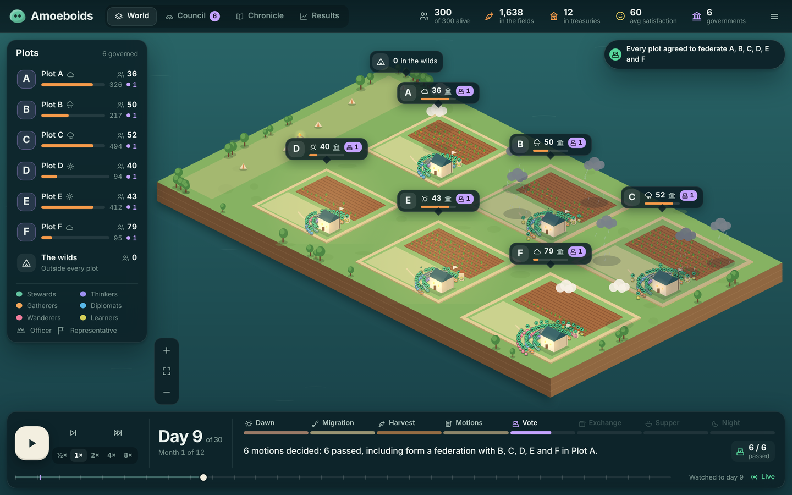

# Amoeboids

A programmable society of autonomous agents, shared carrot plots and institutions that the agents create themselves. The simulation runs in daily phases. Individuals decide how to harvest, eat, think, move, propose, vote and exercise delegated powers. Weather changes mind regeneration; private and government stores preserve food. A meteor resets the world each month, leaving only each individual's private memory.

The default experiment has six behaviours, 50 independent copies of each, six plots and twelve 30-day months. The supplied behaviours are transparent programmed examples, not evidence of learned cooperation.



## Run the MVP

Install **Node 20.18.1+** and **Go 1.23+**:

```sh
git clone https://github.com/AhHamedi/somas-garden.git
cd somas-garden
npm ci
npm run dev
```

Open **http://127.0.0.1:8787** and press **Play**. The island lights up through each day's eight phases while every Amoeboid migrates, harvests, debates, votes, eats and sleeps. Play continues until you pause; selecting things never stops it.

- **World:** select a plot on the map, in the ledger or with the number keys. Its inspector shows what is happening there now, field and treasury, residents with roles and influence, every law in force, today's motions and the day's activity. Select an Amoeboid for its body, mind, food, satisfaction, powers and votes. Widen the inspector with its ↔ button or drag its edge.
- **Council:** every motion seated as a chamber, with the passing line, before and after, and support by team.
- **Rulebook:** every law, charter rule and one-off decision the Amoeboids can vote on, with every option, how it is decided and where it is in force.
- **Chronicle** and **Results:** the month day by day, and a study of the run (outcomes, behaviour, the commons and institutions) with table views and CSV exports.
- The console at the bottom shows the phase, what it achieved, speed (½× to 8×) and a scrubbable month timeline. Space plays and pauses; the arrows step; Shift and the right arrow skip to nightfall. **Menu → New world** changes the setup, with live charts for meals, field regrowth and weather and the respawn rule (by default the dead return at the meteor); **Menu → Team behaviours** edits strategies.

The legacy one-field prototype remains at **/legacy**. Its strategies and old replay format are separate from the new game.

`GO_BINARY` can point to a Go installation. `PORT` and `ENGINE_PORT` choose alternative ports. Local simulation replays and uploaded strategies are saved under `.local/data/society/`; `LOCAL_DATA_DIR` or `SOCIETY_DATA_DIR` can select another location. Never commit `.local/`.

Saved replays survive server restarts. A run whose live process was interrupted reopens as a read-only archive; start a new run to continue experimenting. Browser settings and strategy drafts are also retained locally.

## Design an agent

Use the visual strategy editor for simple decisions and phase-specific rules. For more control, import a Go file through the editor. Start with [the downloadable example](public/society-example.go) and [the agent guide](docs/AGENT_API.md).

Each individual has explicit private JSON memory. The same code may serve 50 individuals, but they do not share mutable global variables. The local Go runner accepts a pure standard-library subset, rejects global mutable state and external I/O, and applies decision timeouts. It is intended for team-authored local experiments; it is not a general internet-facing arbitrary-code execution service.

The plot's **Assembly** tab shows its laws and motions, **Council** shows the votes, and **Rulebook** explains the available local and federal powers. Clicking an observer control does not cast a vote or force an institution into existence. Formation unlocks powers; policies and offices require subsequent votes.

## Specification

[The approved specification](docs/AMOEBOIDS_SPECIFICATION.md) defines the physical rules, political powers, timing, worked examples, information boundaries and monthly resets. [The agent API](docs/AGENT_API.md) defines the corresponding programming interface.

Core features include zero-rule founding, unlimited mind-funded proposals, competing policy votes, delegated officers, storage taxes and inheritance, proportional mind pledges, funded records and enforcement, evidence-based sanctions, federations, representative voting, donations, shared records and immigration checks.

## Reproducible experiments

Run the same engine without the interface:

```sh
go run ./cmd/society -seed 42 -output experiment.json
```

For a smaller experiment:

```sh
go run ./cmd/society -copies 5 -plots 3 -days 10 -months 2 -seed 42
```

`-config setup.json` accepts an object containing `settings` and `teams`. The headless command runs built-in and visual-builder policies. Imported Go strategies run through the local application service, which owns compilation and isolated memory transport.

Compare runs with the same settings and seed. Retaining memory enables agent-written adaptation; improvement must be measured against a memory-reset baseline across multiple seeds before claiming learning.

## Development and verification

```sh
npm test
npx playwright install chromium
npm run test:browser:society
npm run check
```

Go tests exercise physical accounting, information access, institutional timing and political rules. The society browser test exercises the actual service and rendered interface. The legacy browser checks remain available through `npm run test:browser:legacy`.

See [verification results](docs/VERIFICATION.md), the [independent engineering review](docs/DEEP_REVIEW.md) and the [interface review](docs/GAME_UX_REVIEW.md) for measured performance, reviewed flows and remaining limitations. [Presentation decisions](docs/PRESENTATION_DESIGN.md) explain the visual and interaction design.

| Area                                            | Files                                                                                            |
| ----------------------------------------------- | ------------------------------------------------------------------------------------------------ |
| Physical world, phases, memory and observations | `pkg/society/world.go`, `resources.go`, `agents.go`, `types.go`                                  |
| Policies, votes, delegations and federations    | `pkg/society/politics*.go`                                                                       |
| Configurable defaults                           | `pkg/society/settings.go`                                                                        |
| Local runs, history, imports and Go workers     | `api/society.go`, `api/society_strategy.go`                                                      |
| Observer interface                              | `public/society.html`, `public/game/` (map, playback, panels, council, rulebook, results, setup) |
| Headless experiments                            | `cmd/society/main.go`                                                                            |
| Legacy engine and viewer                        | `pkg/garden/`, `public/index.html`                                                               |

## Hosting boundary

The updated MVP uses a persistent local Go service and disk-backed replays. It is ready to clone and run from GitHub. The previous Vercel/Supabase configuration in `hosting/` belongs to the legacy prototype; it does not host the stateful society service. Production multi-user hosting requires a persistent process, durable storage, authentication and a separately hardened execution service. The application does not silently upload local strategies or simulation data.

## Foundation

The original prototype extends `BaseServer` and `BaseAgent` from [basePlatformSOMAS v2.1.0](https://github.com/MattSScott/basePlatformSOMAS/tree/v2.1.0), MIT-licensed, © 2023 Matt Scott. The new society engine implements explicit daily phases separately because the legacy lifecycle models one harvest/contribution action per day. The original package remains available and tested.
